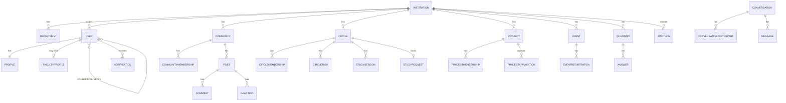

# Architecture

## Shape
A **modular monolith**: one Django project split into focused apps, served over **ASGI** (Daphne) so normal pages and WebSockets
run in one process. Server-rendered Django templates, Tailwind CSS and a little vanilla JavaScript; no separate front-end build or API server.

```
Browser ──HTTPS──> Caddy/Nginx ──> Daphne (ASGI) ──┬─ Django views + templates ──> PostgreSQL
   │                                               └─ Channels consumers (chat, notifications) ──> Redis (channel layer, cache)
   └── WebSocket (/ws/chat/<id>/, /ws/notifications/) ───────────────┘
```

## Apps
| App | Responsibility |
|---|---|
| `core` | Shared pieces: security headers/CSP middleware, rate limiter, image sanitiser, abstract task model, health check, `seed_demo`, `make_admin` |
| `institutions` | Institution (multi-campus ready), department, program, allowed email domains |
| `accounts` | Custom `User` (email login), roles, email verification, password flows, deactivation/deletion/export |
| `profiles` | Profile, interests, skills, onboarding, discovery, match inputs |
| `connections` | Connection requests and blocking |
| `communities`, `discussions`, `moderation` | Communities and membership; posts, comments, reactions; reports and audit of moderator actions |
| `circles`, `study`, `projects` | Small groups (tasks, sessions, links); study requests (backed by a circle); projects, applications, teams |
| `messaging`, `notifications` | Conversations/messages and WebSocket consumers; notification records, live push |
| `faculty`, `events` | Faculty profiles, mentorship, announcements; events and registrations |
| `recommendations` | Campus Match engine, dashboard picks, global search |
| `ask` | Q&A, helpful votes, accepted answers, rule-based badges |
| `campusadmin` | Admin analytics, user/faculty/community management, append-only audit log |
| `dashboard` | Personalised home (feed, picks, rails) |

## Data model (overview)

Every campus-owned record carries an `institution` and every query filters by the viewer's institution, so one campus can never see another's data.
Uniqueness, check constraints (no self-connections, one report target) and indexes are declared in the models and verified on PostgreSQL.

## Real-time design
- **Chat**: the browser opens `ws://…/ws/chat/<id>/`. The consumer authenticates via the session cookie, verifies the user is a participant, and every send goes through one function (`messaging.services.post_message`) that validates, rate-limits, enforces blocking, saves, broadcasts to the channel group and creates a coalesced notification. The same function backs the HTTP fallback.
- **Resilience**: the client reconnects with back-off, catches up on missed messages after reconnecting, falls back to HTTP sending when the socket is down, and to polling after repeated failures.
- **Notifications**: `notifications.services.notify` saves a row and pushes to the user's group `user_<id>`; the bell updates live (or polls every 30 s without WebSockets).
- Development uses an in-memory channel layer; production uses Redis (`REDIS_URL`).

## Matching (Campus Match)
Pure functions over what students entered (interests, skills, goals, study subjects, free times, collaboration style, department/year).
Each rule adds points and a human-readable reason, so nothing is a black box. Scores are normalised into a 0-100 "match strength".
Candidates are limited to discoverable, verified, same-campus students who haven't opted out or been blocked.

## Key decisions
- **Custom user model from day one**, email as the login, role + institution on the user.
- **Server-side authorisation everywhere**: views look objects up inside the viewer's institution and raise 404 for anything they may not see (no information leak about what exists).
- **No paid AI** for any core feature; recommendations are deterministic and explainable.
- **Soft removal for moderation** (kept for audit), hard deletion for a user's own content.
- **Pre-compiled Tailwind + a strict CSP**: no third-party scripts at runtime; only Google Fonts are allowed.
